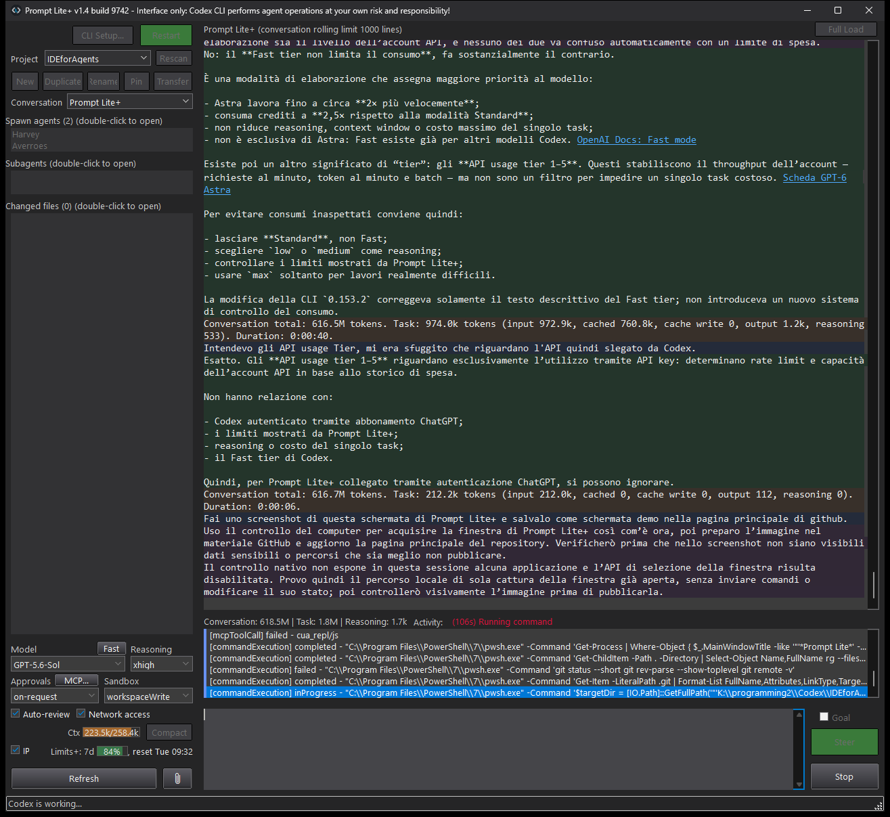

# TMI Lite+ for AI agents

**Lightweight interface for AI agents**

TMI Lite+ is an independent Windows x64 interface for Codex CLI, designed to
keep AI-assisted development practical on computers with limited performance.
It provides projects and conversations, working directories, model/reasoning
controls, approvals, activity, files, diffs and token/usage information without
heavy conversation rendering.

Monitor consumption over time and inspect each task's input, cached input,
cache writes, output, reasoning tokens and elapsed time. On-demand Usage charts
and host-owned working-time statistics help compare workflows without claiming
to calculate subscription billing costs.

Version **2.3** is a **stable release** (28 October 2026), with an independent
**2.x Rolling** channel for subsequent updates.
Stable Windows executable version: **2.3.9797.42811** (Release/Win64).
Current Rolling Windows executable version: **2.2.9796.17082**
(Release/Win64, 27 October 2026).
Stable 2.3 was primarily tested with Codex CLI **0.164.0**; installed-version
selection and focused compatibility checks also covered **0.165.0**. This is
not a guarantee for every capability or later CLI build.

## What's new in stable 2.3

- **Interactive inline graphics:** Visualize widgets and Mermaid diagrams work
  directly in the conversation. Offscreen views suspend without losing their
  state; the existing history-preview budget keeps large reloads lightweight.
- **Local project notes:** one Markdown note per file in each working
  directory's `.tmi-notes` folder, project-wide chronological listing,
  priority/completed flags, explicit editing and conflict-aware autosave.
- **Auto switch and clearer activity:** optional host-owned switching between
  existing frontends, native taskbar attention, and independent tray badges for
  Working, Codex response warnings and user decisions.
- **Sample, diagnostics and Memories:** temporary tool-free answers use the
  conversation renderer; diagnostic ZIPs are explicitly requested and stay
  local. A nonmodal Memory viewer and native Memories configuration expose the
  shared Codex summary, not the active model context.
- **Live IDE Bridge diffs:** compatible Bridge operations populate Changed
  Files and compact Activity summaries; immutable patches load only on request.
- **Faster, bounded CLI maintenance:** publish local readiness before optional
  background checks, select an already installed CLI, and control previous-minor
  and release-age retention. Update indicators compare against the newest
  installed version, so selecting a rollback does not offer it again.
- **Recovery fixes:** a valid manual model choice reopens the same older thread;
  obsolete saved/default models resolve from the advertised catalog. Accepting
  an authoritative CLI path no longer creates a false shared-settings conflict.
- **More reliable Worktime:** only active-thread Limits events feed statistics;
  sub-minute reset-time jitter no longer splits cycles at 99% or 100%.

See [Release Notes](RELEASE_NOTES.md) for details and limitations.

## Stable 2.2 improvements retained

- **Inline graphics completed:** Visualize widgets, Mermaid diagrams and
  optional local LaTeX render inside the conversation. Open a separate nonmodal
  viewer for interaction, zoom and image copying; resize reuses cached images.
- **Lightweight history:** reload automatically renders only the newest **3**
  graphic occurrences across all three formats. Older elements remain textual
  and open on request. Configure the shared limit, including **0** for no
  automatic history graphics; new live messages keep their normal previews.
- **Clearer Configuration:** separate preferences and update groups, descriptive
  selectors, and the new history-preview limit alongside existing options.
- **Multi-frontend polish:** thread activity reorders the lists in the other
  frontends too. Questions supports Ctrl+Enter for replies, without inserting
  a newline into the submitted answer.
- **Startup presentation:** the frontend shows and requests the foreground
  before connecting to or launching the host, instead of appearing behind
  existing windows.

Version 2.2 also retains these stable 2.1 improvements:

- **Worktime statistics:** the host sums resident Working time per 1% drop of
  the shared subscription limit. The latest 200 measurements are normalized per
  percentage point and retained across resets. Click for Current / Past / All
  graphs. Small reset-time estimates and stale values from parallel threads no
  longer split the measurements. This is approximate local data, not billing.
- **Local scheduled prompts:** host-owned schedules run without an open frontend,
  with one-shot/repeating times, thread/new-thread targets and append/steer/absolute
  delivery. Manage upcoming events and missed one-shots in the frontend, or pause
  all scheduling from the tray. Delivery waits until startup/maintenance loading
  has settled, then observes 20 seconds of quiet.
- **Clear Goal controls:** Goal submits an objective independently of Append;
  its colored state row keeps edit, pause/resume and delete controls available.
- **More reliable recovery:** preserve persisted intermediate messages when no
  final answer exists, distinguish native retrying from terminal errors, and
  restore frontend startup/readiness without leaving a dead subscription open.
- **Multi-frontend navigation:** selecting a thread already open in TMI activates
  its existing frontend; external writer conflicts show an understandable message.
- **Queue and layout:** the Queue panel covers the conversation with a yellow
  attention state; the thread overlay follows the Agents/Changed Files panel.
- **Changed Files and diffs:** file access stays enabled without sending a prompt.
  Diff is the first menu command, Open the second, and double-click opens the
  file. Ctrl/Shift selects multiple diffs; opening the viewer selects the latest
  edit and all edits with the same timestamp to the second.
- **Agent snapshots while working:** inspect an agent's conversation through
  its parent's process without resuming it or changing the parent writer.

The independent Rolling channel contains `TMILitePlusBundle-2.2.9796.17082-Win64.zip` in the
[2.x Rolling release](https://github.com/SbiriJJ/tmi-lite-plus/releases/tag/rolling-2).
Publishing stable 2.3 advances `stable-2` and GitHub's Latest numbered release.
It does not replace the independent Rolling package, frozen earlier ZIPs or
legacy 1.x assets/endpoints.

## Core 2.x features

- **Resident backend:** one tray host owns an independent Codex app-server
  process for each work. Closing or switching a frontend detaches it, without
  stopping the work. Reattach later or use multiple frontends side by side.
- **Sessions and tray:** inspect resident works, open the thread needing a
  reply, and distinguish working, waiting and error states. Approvals/questions
  are handled in the owning frontend, never silently answered by the host.
- **TMI Computer Use:** local `tmi_desktop` tools discover and read Windows
  windows, capture images and operate controls. Native window messages support
  background interactions without TMI changing focus; UIA and physical input
  remain explicit alternatives. Separate read/control permissions, visible
  blue/red warnings and physical ESC interruption are included.
- **On-demand maintenance:** CLI Setup runs in `TMIMaintenance.exe`, not a
  permanently loaded setup form. The host suspends idle Codex connections while
  maintenance is open and reconnects them afterwards; active work blocks it.
- **Version-family updates:** 2.x Release and Rolling download the complete
  matching binary/assets/documentation bundle through their own endpoints.
  Existing 1.x installations do not receive a 2.x package automatically.
- **Projects and threads:** server-backed search, shared Pinned entries and a
  permanent Archived group. Documents includes the current user's Windows-known
  Documents folder and all subfolders. Working directory and project are
  independent; selecting a folder no longer creates a project implicitly.
- **Compact controls and graphics:** colored toggle buttons; inline Visualize,
  Mermaid and optional LaTeX previews, with separate on-demand viewers for
  interaction, zoom and image copy. History previews have a configurable limit.
- **Existing tools retained:** bounded conversation loading, Full Load/search,
  diffs, Changed Files, Usage charts, Questions, attachments, native prompt
  queue, Goal, Unicode formulas and optional local LaTeX rendering.

See [Release Notes](RELEASE_NOTES.md) for changes, verification and limitations.

## Download and installation

1. Open the [TMI Lite+ 2.3 release](https://github.com/SbiriJJ/tmi-lite-plus/releases/tag/v2.3) and download its Win64 ZIP.
2. Check the archive against its published SHA-256 checksum.
3. Extract the **complete** archive into a writable directory.
4. Start `TMILitePlus.exe` and accept the versioned disclaimer/EULA.
5. Use **CLI Setup** if Codex CLI needs installing/updating, then authenticate separately with `codex login` if needed. TMI does not yet provide a native login screen.

Keep `TMILitePlus.exe`, `TMIHost.exe`, `TMIDesktop.exe`,
`TMIMaintenance.exe`, the supplied documentation and viewer assets together.
Install matching binaries from one bundle; local IPC protocol **16** rejects
incompatible peers. Do not run from inside the ZIP or replace a running host by
copying only one executable.

The neutral INI contains no personal project/thread paths, credentials,
accepted EULA or internal switches. Local preferences remain beside the
frontend. Common defaults and desktop grants use the current user's registry.

When upgrading from 1.x, finish existing work, exit all old frontends and exit
any running TMI host before extracting the complete 2.3 bundle. Retain backups
of your settings and Codex data. Earlier published ZIPs remain available.

## Requirements

- 64-bit Windows.
- Separately installed and authenticated Codex CLI; this release was tested
  primarily with **0.164.0**, with focused **0.165.0** checks.
- An account/service supported by Codex CLI.
- For Visualize and Mermaid: Microsoft Edge WebView2 Runtime, installed separately.
- For graphical LaTeX only: the optional renderer described in
  [MicroTeX Setup](MICROTEX_SETUP.md). MicroTeX binaries/fonts are not included.

No AI model, account, subscription, Codex CLI, WebView2 Runtime or cloud Work
service is supplied by TMI Lite+. Optional viewers initialize only when needed.
Mermaid's local library and required license notices are included. Generic MCP
Apps rendering is not included.

## Screenshot

This screenshot shows the earlier 1.x interface; it is not a screenshot of the
2.x backend, Computer Use or current thread browser.

## Responsibility and independence

TMI Lite+ is hobby-developed software provided free of charge and may be used
for any lawful personal or professional purpose. It is not designed, certified,
supported or warranted for professional, production, safety-critical or
business-continuity use. Such use is entirely at the user's discretion and risk.

Codex CLI performs agent operations. TMI also performs its own local client and
Computer Use operations under the permissions selected by the user. Review
commands, output, file changes and grants; maintain backups.

TMI Lite+ is not affiliated with, endorsed by, sponsored by or supported by
OpenAI. It can coexist with the **ChatGPT desktop app**, but **do not use both
applications on the same project at the same time**. TMI provides no
cross-client coordination with that app.

## Documentation

- [End User License Agreement](EULA.md)
- [Legal and Copyright Notice](LEGAL_NOTICE.md)
- [Privacy Notice](PRIVACY.md)
- [Third-Party Notices](THIRD_PARTY_NOTICES.md)
- [User Guide](USER_GUIDE.md)
- [Release Notes](RELEASE_NOTES.md)
- [Optional MicroTeX Setup](MICROTEX_SETUP.md)
- [Development Notes](DEVELOPMENT_NOTES.md)

The **2.3 ZIP is linked directly above**, and v2.3 is GitHub's Latest numbered
release. Use the complete 2.x bundle, not an old single-EXE update package.
The 2.x **Release** channel uses `stable-2`; **Rolling** uses `rolling-2`.
The [2.x Rolling release](https://github.com/SbiriJJ/tmi-lite-plus/releases/tag/rolling-2)
contains the current rolling bundle, separately from stable v2.3. Legacy 1.x
assets and its `rolling` endpoint are preserved and may receive separate 1.x
updates; the old updater does not recognize 2.x bundle filenames.

The visible Release/Rolling choices and check schedules remain unchanged.
Remote 2.x packages stage all four executables plus supplied runtime assets
and documentation; personal INI settings are never overwritten. Package names
use `TMILitePlusBundle-2.3.G.T-Win64.zip` for this release, which the legacy updater does not
recognize. Upgrade from 1.x remains a manual full-ZIP installation.
See the User Guide for coordinated local/remote updates. Official Codex documentation:
[developers.openai.com/codex](https://developers.openai.com/codex/).
