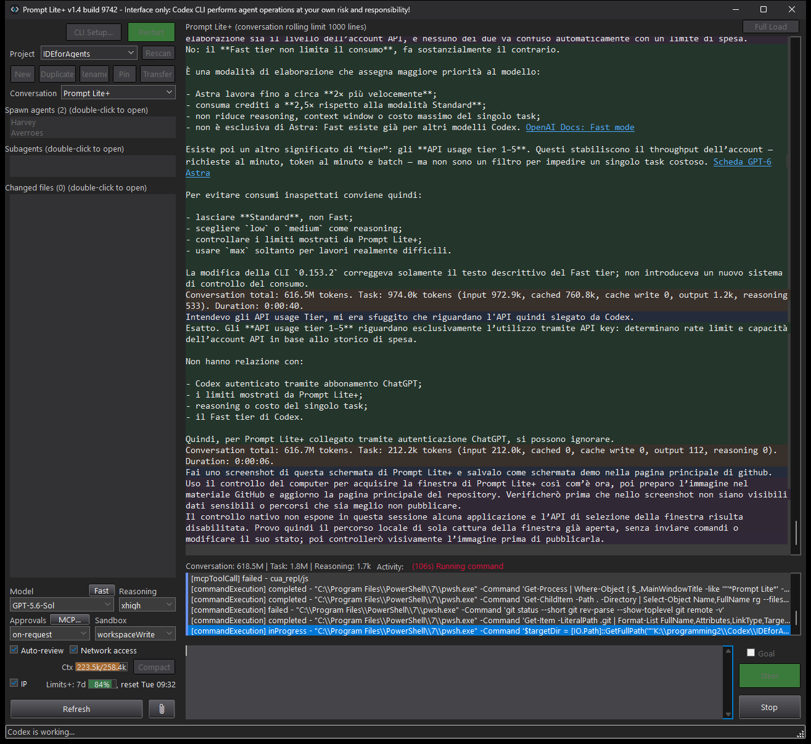

# TMI Lite+ for AI agents

**Lightweight interface for AI agents, with local and remote computer control**

TMI Lite+ is an independent Windows x64 interface for Codex CLI, designed to
keep AI-assisted development practical on computers with limited performance.
It provides projects and conversations, working directories, model/reasoning
controls, approvals, activity, files, diffs and token/usage information without
heavy conversation rendering.

With **TMI Remote**, an agent can also read and operate a second Windows computer
over a trusted LAN, using a small console EXE and INI on that computer. Explicit
operator consent, RO/RW access, visible borders and global ESC interruption keep
remote access under the remote operator's control. No ChatGPT desktop app or
Codex installation is required on the remote computer.

Monitor consumption over time and inspect each task's input, cached input,
cache writes, output, reasoning tokens and elapsed time. On-demand Usage charts
and host-owned working-time statistics help compare workflows without claiming
to calculate subscription billing costs.

Published stable Windows executable version: **2.5.9806.24165** (Release/Win64).
Independent **2.x Rolling** build: **2.6.9811.21485**
(Release/Win64, 11 November 2026).
Codex CLI **0.167.0** integration and regression checks are included, with
focused compatibility checks covering **0.164.0 / 0.165.0 / 0.166.0**.
This is not a guarantee for every capability or later CLI build.

## What's new in Rolling 2.6.9811.21485

- **Pick a window:** click the window icon, then a local window to add its title,
  executable, HWND, PID, class and click coordinates to the prompt draft. The
  selection click is not passed to the target. Esc cancels.
- **Capture an area:** the camera icon opens a dimmed desktop preview. Drag to
  select, redraw as needed, then use the secondary mouse button to confirm.
  TMI saves a PNG in the Windows Pictures folder under `TMI` and attaches it to
  the draft without sending the prompt or modifying the clipboard.

This Rolling bundle also includes the following changes prepared for stable 2.6:

- **Remote window monitor:** deliver complete client-area PNGs to a local TCP
  reader on the Host, on request, at intervals, or when the pixels change. A
  fixed crop can capture just the area you need. Automatic captures do not take
  focus, and an already approved RO connection is sufficient.
- **Clearer inline Questions:** proposed answers start with **Quick reply ->**;
  duplicate question text appears once. Only the answer is submitted.
- **Reset credits and links:** use an available reset credit before limits reach
  zero, with explicit confirmation. Bracketed text no longer causes unrelated
  conversation lines to be highlighted as links.

Update both Host and Remote to use the monitor. The Win32 monitor delivered
two live PNGs of a cropped Quindos-Graphics window on an XP VM without taking
focus. Areas that are off-screen or covered are refused. See the
[User Guide](USER_GUIDE.md#window-monitor) for usage and limits.

## What's new in stable 2.5

- **Clear human approval requests:** a prominent amber header, exact command
  and separate working directory make the decision evident. Technical details
  stay collapsed. Native human checkpoints offer only Accept, Decline and Cancel;
  Auto-review and remembered grants cannot answer them.
- **Reliable approval delivery:** requests remain pending until acknowledged by
  the host or resolved by Codex. Refusals stay actionable with an explanation;
  uncertain decisions and commands are never resent automatically.
- **Better tool and thread feedback:** MCP summaries expose available tool
  annotations without treating them as permission. CLI 0.167 section events
  synchronize Pinned membership/order without reloading conversations.
- **Interactive Visualize controls:** keyboard-accessible tabs, variant
  carousels and mouse/keyboard/touch tooltips use the existing lightweight viewer.
- **Safer thread operations:** list actions keep their original target through
  asynchronous updates. A blank New directory resolves from the selected project's
  roots or Windows Documents, never from another work or the executable folder.
- **Safety review when supplied by Codex:** Review findings shows the server's
  explanation and continuation for an explicit user decision. No local approval
  can revive a server-terminated chat or invent a continuation.

The main bundle keeps local IPC protocol 17. Version 2.5 introduced the following
Rolling 2.4 improvements, also included in 2.6.

## Rolling 2.4 improvements included in 2.5

- **Answer Questions inline:** click a proposed answer in the conversation to
  send it immediately, without replacing the prompt draft or sending duplicates.
  The Questions window remains available for several questions and free-text
  replies. Reloaded historical options stay plain text.
- **Visible Remote notice:** each target monitor shows **Codex is using your
  computer (ESC to disconnect)** throughout the connection, azure for RO and red
  for RW. The native click-through notice takes no focus and has no taskbar
  entry; neither Remote edition adds a graphical framework or runtime library.
- **Open source references at their line:** choose Visual Studio Code, BowPad,
  Notepad++ or the Windows default in Configuration. Pascal units (`.pas`)
  take priority in an already-running Delphi IDE when the separately installed
  IDE Bridge supports source navigation; no IDE is started and no project is changed.
- **Copy reply:** right-click an agent reply to copy it. An existing text
  selection is copied immediately instead; left-click behavior is unchanged.
- **More reliable Worktime:** use quota and the next reset time together to
  distinguish actual resets from a moving deadline. Ordinary drops still show
  time per percentage point; pending time at a reset goes to the closing cycle.
- **Opt-in host diagnostics:** enable **Diagnostics** in the host tray menu to
  make recent Worktime decisions available to the agent for its own work.
  The bounded buffer is in memory, off by default and cleared when disabled.

## What's new in stable 2.4

- **Remote computer control:** connect by IPv4 to a Windows computer running
  `TMIRemote64` or the separate legacy `TMIRemote86`. The matching EXE and INI
  are sufficient; there is no Remote service, tray app or AI account to install.
- **Operator-controlled access:** approve RO access, explicitly approve an RW
  upgrade when needed, or authorize both modes at the first request. A fixed
  azure/red border shows the active scope on the remote screen. ESC interrupts
  from any window while connected, revokes the grant and requires fresh consent.
- **Robust task connections:** normal release retains the in-memory grant;
  Remote retries a lost link without a silent session expiry. Stable request
  identities prevent replaying an uncertain action; inspect status after a timeout.
- **Cleaner first use:** the host requests native Codex browser login when
  required. New offers optional directory, title and existing/new project;
  unspecified fields use normal Codex behavior. New settings preserve the chosen
  model/reasoning, and an unset sandbox starts Read-only rather than Workspace-write.
- **Focused reliability fixes:** conservative permission validation retains
  drafts on failure, unsupported Steer during compaction is prevented, and the
  Remote console paints its first border before admitting access. Fresh Y/N
  input is required for each authorization.

**Remote is for operator-controlled trusted LANs only. Its TCP traffic is not
encrypted and IP authorization is not cryptographic authentication. Do not expose
it to the Internet.** XP VM consent, Unicode writes, full-window PNG and ESC tests
passed; physical-LAN outage tests, real Remote64 deployment and Windows 2000
execution remain unverified. See [Remote computer control](#remote-computer-control).

Version 2.4 also includes these improvements from Rolling 2.3.9798.40375:

- **Codex 0.166 integration:** Activity, historical entries and diffs use native
  item timestamps when available. Native tool duration remains authoritative;
  earlier CLI versions retain their existing timestamp behavior.
- **Active CLI version:** the label beside Memory shows the version running
  the selected work, not the latest installed version. The host owns executable
  selection after Maintenance, including reconnects from older frontends.
- **Safer CLI updates:** availability follows the official installer channel;
  install/update pins the displayed release and verifies the resulting binary.
  A mismatch does not replace the configured selection or prune older versions.
- **On-demand network diagnostics:** CLI Setup streams a focused network report
  with a bounded timeout, without automatic scans or configuration changes.
- **Lightweight startup:** compatible CLI launches skip marketplace recommendation
  prefetch, retaining installed plugins and the existing Browser Tools toggle.
  Capacity-unavailable responses get a distinct status; Codex still owns retries.
- **Recovery and UI fixes:** dead process state is invalidated coherently, New
  retains its first prompt if opening fails, disabled schedules cannot dispatch
  queued jobs, downloads can be cancelled, and CLI Setup inputs stay dark.

The `stable-2` channel and GitHub's Latest numbered release provide stable
2.5. Rolling updates use `rolling-2`. The stable 2.3 improvements below are
retained.

## What's new in stable 2.3

- **Interactive inline graphics:** Visualize widgets and Mermaid diagrams work
  directly in the conversation. Offscreen views suspend without losing their
  state; the existing history-preview budget keeps large reloads lightweight.
- **Local project notes:** one Markdown note per file in each working
  directory's `.tmi-notes` folder, project-wide chronological listing,
  priority/completed flags, explicit editing and conflict-aware autosave.
- **Auto switch and clearer activity:** optional host-owned switching between
  existing frontends, native taskbar attention, and independent tray badges for
  Working, Codex response warnings and user decisions.
- **Sample, diagnostics and Memories:** temporary tool-free answers use the
  conversation renderer; diagnostic ZIPs are explicitly requested and stay
  local. A nonmodal Memory viewer and native Memories configuration expose the
  shared Codex summary, not the active model context.
- **Live IDE Bridge diffs:** compatible Bridge operations populate Changed
  Files and compact Activity summaries; immutable patches load only on request.
- **Faster, bounded CLI maintenance:** publish local readiness before optional
  background checks, select an already installed CLI, and control previous-minor
  and release-age retention. Update indicators compare against the newest
  installed version, so selecting a rollback does not offer it again.
- **Recovery fixes:** a valid manual model choice reopens the same older thread;
  obsolete saved/default models resolve from the advertised catalog. Accepting
  an authoritative CLI path no longer creates a false shared-settings conflict.
- **More reliable Worktime:** only active-thread Limits events feed statistics;
  sub-minute reset-time jitter no longer splits cycles at 99% or 100%.

See [Release Notes](RELEASE_NOTES.md) for details and limitations.

## Stable 2.2 improvements retained

- **Inline graphics completed:** Visualize widgets, Mermaid diagrams and
  optional local LaTeX render inside the conversation. Open a separate nonmodal
  viewer for interaction, zoom and image copying; resize reuses cached images.
- **Lightweight history:** reload automatically renders only the newest **3**
  graphic occurrences across all three formats. Older elements remain textual
  and open on request. Configure the shared limit, including **0** for no
  automatic history graphics; new live messages keep their normal previews.
- **Clearer Configuration:** separate preferences and update groups, descriptive
  selectors, and the new history-preview limit alongside existing options.
- **Multi-frontend polish:** thread activity reorders the lists in the other
  frontends too. Questions supports Ctrl+Enter for replies, without inserting
  a newline into the submitted answer.
- **Startup presentation:** the frontend shows and requests the foreground
  before connecting to or launching the host, instead of appearing behind
  existing windows.

Version 2.2 also retains these stable 2.1 improvements:

- **Worktime statistics:** the host sums resident Working time per 1% drop of
  the shared subscription limit. The latest 200 measurements are normalized per
  percentage point and retained across resets. Click for Current / Past / All
  graphs. Small reset-time estimates and stale values from parallel threads no
  longer split the measurements. This is approximate local data, not billing.
- **Local scheduled prompts:** host-owned schedules run without an open frontend,
  with one-shot/repeating times, thread/new-thread targets and append/steer/absolute
  delivery. Manage upcoming events and missed one-shots in the frontend, or pause
  all scheduling from the tray. Delivery waits until startup/maintenance loading
  has settled, then observes 20 seconds of quiet.
- **Clear Goal controls:** Goal submits an objective independently of Append;
  its colored state row keeps edit, pause/resume and delete controls available.
- **More reliable recovery:** preserve persisted intermediate messages when no
  final answer exists, distinguish native retrying from terminal errors, and
  restore frontend startup/readiness without leaving a dead subscription open.
- **Multi-frontend navigation:** selecting a thread already open in TMI activates
  its existing frontend; external writer conflicts show an understandable message.
- **Queue and layout:** the Queue panel covers the conversation with a yellow
  attention state; the thread overlay follows the Agents/Changed Files panel.
- **Changed Files and diffs:** file access stays enabled without sending a prompt.
  Diff is the first menu command, Open the second, and double-click opens the
  file. Ctrl/Shift selects multiple diffs; opening the viewer selects the latest
  edit and all edits with the same timestamp to the second.
- **Agent snapshots while working:** inspect an agent's conversation through
  its parent's process without resuming it or changing the parent writer.

The independent Rolling channel provides `TMILitePlusBundle-2.6.9811.21485-Win64.zip` in the
[2.x Rolling release](https://github.com/SbiriJJ/tmi-lite-plus/releases/tag/rolling-2).
Its separate `TMIRemote-2.6.9811.21485-Windows.zip` updates the two Remote
editions; copy the selected EXE to the target manually and keep its existing INI.
Stable 2.5 remains on `stable-2` and is GitHub's Latest numbered release.
Publishing Rolling does not replace that stable package, frozen earlier ZIPs or
legacy 1.x assets/endpoints.

## Core 2.x features

- **Resident backend:** one tray host owns an independent Codex app-server
  process for each work. Closing or switching a frontend detaches it, without
  stopping the work. Reattach later or use multiple frontends side by side.
- **Sessions and tray:** inspect resident works, open the thread needing a
  reply, and distinguish working, waiting and error states. Approvals/questions
  are handled in the owning frontend, never silently answered by the host.
- **TMI Computer Use:** local `tmi_desktop` tools discover and read Windows
  windows, capture images and operate controls. Native window messages support
  background interactions without TMI changing focus; UIA and physical input
  remain explicit alternatives. Separate read/control permissions, visible
  blue/red warnings and physical ESC interruption are included.
- **TMI Remote:** read and control another Windows computer through the same
  agent, with a separately deployed console, IPv4 routing and operator consent.
  Local tools remain available independently.
- **On-demand maintenance:** CLI Setup runs in `TMIMaintenance.exe`, not a
  permanently loaded setup form. The host suspends idle Codex connections while
  maintenance is open and reconnects them afterwards; active work blocks it.
- **Version-family updates:** 2.x Release and Rolling download the complete
  matching binary/assets/documentation bundle through their own endpoints.
  Existing 1.x installations do not receive a 2.x package automatically.
- **Projects and threads:** server-backed search, shared Pinned entries and a
  permanent Archived group. Documents includes the current user's Windows-known
  Documents folder and all subfolders. Working directory and project are
  independent; selecting a folder no longer creates a project implicitly.
- **Compact controls and graphics:** colored toggle buttons; inline Visualize,
  Mermaid and optional LaTeX previews, with separate on-demand viewers for
  interaction, zoom and image copy. History previews have a configurable limit.
- **Existing tools retained:** bounded conversation loading, Full Load/search,
  diffs, Changed Files, Usage charts, Questions, attachments, native prompt
  queue, Goal, Unicode formulas and optional local LaTeX rendering.

See [Release Notes](RELEASE_NOTES.md) for changes, verification and limitations.

## Download and installation

1. Download the Win64 ZIP from the [stable 2.5 release](https://github.com/SbiriJJ/tmi-lite-plus/releases/tag/v2.5) or the [2.x Rolling release](https://github.com/SbiriJJ/tmi-lite-plus/releases/tag/rolling-2).
2. Check the archive against its published SHA-256 checksum.
3. Extract the **complete** archive into a writable directory.
4. Start `TMILitePlus.exe` and accept the versioned disclaimer/EULA.
5. Use **CLI Setup** if Codex CLI needs installing/updating. When ChatGPT authentication is required, the host starts Codex's native browser login; complete it in the browser. TMI stores no OpenAI password or access token of its own.

Keep `TMILitePlus.exe`, `TMIHost.exe`, `TMIDesktop.exe`,
`TMIMaintenance.exe`, the supplied documentation and viewer assets together.
Install matching binaries from one bundle; local IPC protocol **17** rejects
incompatible peers. Do not run from inside the ZIP or replace a running host by
copying only one executable.

The neutral INI contains no personal project/thread paths, credentials,
accepted EULA or internal switches. Local preferences remain beside the
frontend. Common defaults and desktop grants use the current user's registry.

When upgrading from 1.x, finish existing work, exit all old frontends and exit
any running TMI host before extracting the complete 2.x bundle. Retain backups
of your settings and Codex data. Earlier published ZIPs remain available.

## Requirements

- 64-bit Windows.
- Separately installed and authenticated Codex CLI; focused checks cover
  **0.164.0 / 0.165.0 / 0.166.0 / 0.167.0** as described above.
- An account/service supported by Codex CLI.
- For Visualize and Mermaid: Microsoft Edge WebView2 Runtime, installed separately.
- For graphical LaTeX only: the optional renderer described in
  [MicroTeX Setup](MICROTEX_SETUP.md). MicroTeX binaries/fonts are not included.

No AI model, account, subscription, Codex CLI, WebView2 Runtime or cloud Work
service is supplied by TMI Lite+. Optional viewers initialize only when needed.
Mermaid's local library and required license notices are included. Generic MCP
Apps rendering is not included.

## Remote computer control

The host/frontends still require 64-bit Windows. A **remote target** can use the
modern Win64 console or the separate Win32 console tested on an XP VM:

1. Download the separate **TMI Remote Windows ZIP** from the same
   [stable](https://github.com/SbiriJJ/tmi-lite-plus/releases/tag/v2.5) or
   [Rolling](https://github.com/SbiriJJ/tmi-lite-plus/releases/tag/rolling-2) release as the Host and
   verify its published SHA-256. Copy the matching `TMIRemote64.exe` +
   `TMIRemote64.ini`, or `TMIRemote86.exe` + `TMIRemote86.ini`, to the target.
2. Set `HostIP` in that INI to the actual IPv4 address of the TMI Host computer.
   Remote initiates TCP to Host, default port **47931**; it does not listen for
   unrestricted incoming clients. Allow that Host port manually if needed.
3. Start the Remote console and ask the agent to connect to the **remote target's
   IP**. The operator verifies the Host IP/scope and presses **Y** or **N**.
4. The agent can inspect windows, read content or request supported actions.
   `Permission=RO` requires separate approval for a later RW upgrade; denying
   the upgrade keeps RO. `Permission=RW` asks for both modes at first consent.
5. A fixed **azure RO / red RW** border stays visible throughout the task
   connection, including outages. **ESC from any window** immediately revokes
   it. A normal agent release ends the task connection but keeps consent in
   memory until Remote restart or ESC in the idle Remote console.

No installation, Codex, OpenAI login or extra deployment DLL is required on the
target. Win32 uses native window messages/GDI, not UIA or physical input, and
does not offer every Win64 operation. Windows 2000 and actual Remote64 deployment
are not yet validated. Connection-loss/recovery has isolated regression coverage;
its physical-LAN operator test remains pending. This is **not encrypted remote
administration for untrusted networks**. Read the [User Guide](USER_GUIDE.md#tmi-remote-trusted-lan)
and the README supplied in the Remote ZIP before enabling access. Remote is an
optional, separately deployed package; normal frontend updates do not replace
an EXE or INI on another computer.

## Screenshot

This screenshot shows the earlier 1.x interface; it is not a screenshot of the
2.x backend, Computer Use or current thread browser.

## Responsibility and independence

TMI Lite+ is hobby-developed software provided free of charge and may be used
for any lawful personal or professional purpose. It is not designed, certified,
supported or warranted for professional, production, safety-critical or
business-continuity use. Such use is entirely at the user's discretion and risk.

Codex CLI performs agent operations. TMI also performs its own client,
local Computer Use and optional Remote operations under the permissions selected by the user. Review
commands, output, file changes and grants; maintain backups.

TMI Lite+ is not affiliated with, endorsed by, sponsored by or supported by
OpenAI. It can coexist with the **ChatGPT desktop app**, but **do not use both
applications on the same project at the same time**. TMI provides no
cross-client coordination with that app.

## Documentation

- [End User License Agreement](EULA.md)
- [Legal and Copyright Notice](LEGAL_NOTICE.md)
- [Privacy Notice](PRIVACY.md)
- [Third-Party Notices](THIRD_PARTY_NOTICES.md)
- [User Guide](USER_GUIDE.md)
- [Release Notes](RELEASE_NOTES.md)
- [Optional MicroTeX Setup](MICROTEX_SETUP.md)
- [Development Notes](DEVELOPMENT_NOTES.md)

The stable and Rolling ZIPs are linked above. Use the complete 2.x bundle, not
an old single-EXE update package.
The 2.x **Release** channel uses `stable-2`; **Rolling** uses `rolling-2`.
The [2.x Rolling release](https://github.com/SbiriJJ/tmi-lite-plus/releases/tag/rolling-2)
contains the rolling bundle, separately from stable v2.5. Legacy 1.x
assets and its `rolling` endpoint are preserved and may receive separate 1.x
updates; the old updater does not recognize 2.x bundle filenames.

The visible Release/Rolling choices and check schedules remain unchanged.
Remote 2.x packages stage all four executables plus supplied runtime assets
and documentation; personal INI settings are never overwritten. Package names
use `TMILitePlusBundle-2.x.G.T-Win64.zip`, which the legacy updater does not
recognize. Upgrade from 1.x remains a manual full-ZIP installation.
See the User Guide for coordinated local/remote updates. Official Codex documentation:
[developers.openai.com/codex](https://developers.openai.com/codex/).
